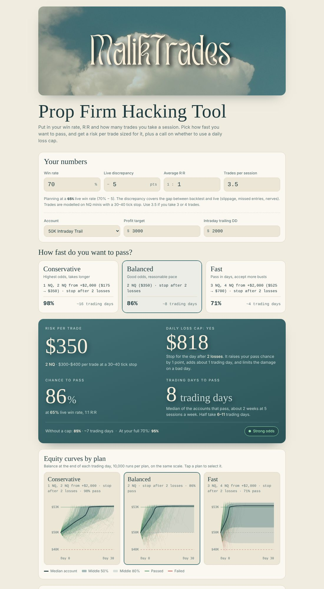

# Prop Firm Hacking Tool

Find the right NQ size for a prop firm evaluation from your own trading stats. Enter your win rate, live discrepancy, average R:R and trades per session, pick how fast you want to pass, and the tool tells you:

- **What size to trade** (whole NQ contracts, or a simple step-up plan)
- **Whether to use a daily loss cap**, and where to set it
- **Your chance of passing**
- **How many trading days it takes**
- **Equity curves** from 10,000 simulated evaluations of your plan

Built by **MalikTrades**.

## How to use it

1. **Your numbers.** Enter your win rate, live discrepancy (how many points worse you trade live than in backtest), average R:R and trades per session. Use 3.5 if you take 3 or 4 trades.
2. **Account.** Choose the account size, then check the profit target and intraday trailing drawdown against your firm's current rules.
3. **Pick a speed.**
   - **Conservative:** highest odds, takes longer
   - **Balanced:** good odds at a reasonable pace
   - **Fast:** pass in days, but more blown accounts
4. Read your size, loss cap, pass chance and trading days. Tap any plan's equity curve to switch to it.

**Use your live stats, not your backtest.** The results are only as honest as the numbers you put in.

### Step-up plans

Some plans change size partway through, for example *"Start on 1 NQ. Once you're up $1,000, trade 2 NQ."* You trade small while the account is fresh and size up once you're ahead. If you drop back below that profit level, you go back to the smaller size.

## How the numbers are made

Every result comes from a Monte Carlo simulation that plays out 10,000 evaluations trade by trade.

| Assumption | Value |
|---|---|
| Instrument | NQ minis, $5 per tick |
| Stop size | Random between 30 and 40 ticks per trade |
| Win | Stop size × your R:R |
| Commission | $4.50 per NQ, round turn |
| Win rate used | Your win rate minus the live discrepancy |
| Session swing | Each session's win rate varies up to ±10 points around that rate; the average stays the same |
| Drawdown | Intraday trailing: follows your highest balance including open profit. Losing trades are assumed to run up to halfway to target before reversing to the stop |
| Pass | The moment the balance reaches the profit target |

**Choosing the plans.** The tool tests every whole NQ size the drawdown allows, plus step-up plans, and picks:

- **Conservative:** the quickest option within 3 points of the best possible pass chance
- **Fast:** the quickest option within 30 points of it
- **Balanced:** the quickest option between them whose pass chance is at least halfway between the other two

**Loss cap advice.** For each plan it compares stopping after 1, 2 or 3 losses against no cap, on the same simulated sessions.

| Advice | Meaning |
|---|---|
| Yes | A cap doesn't lower your pass chance and fits the plan's time budget (up to 50% extra time for Conservative, 25% for Balanced, 10% for Fast). The tightest cap that fits is recommended. |
| Optional | A cap only helps by costing more time than that. |
| No | Every cap lowers your odds. |

**Trading days** are sessions you actually trade. Times shown are the median of the accounts that pass.

### Verification

The engine was checked two ways:

- **Against an exact solution.** With fixed stops, no commission and no session swing, pass probability on a trailing drawdown can be solved exactly as a Markov chain. The simulator matched it within sampling error.
- **Against a separate implementation.** A second simulator written independently in Python agreed to within 1 percentage point across dozens of setups.

## Run it

It's a single HTML file with no build step and no dependencies to install.

- **Locally:** download `index.html` and open it in a browser.
- **GitHub Pages:** in this repo, go to **Settings → Pages**, set the source to **Deploy from a branch**, pick `main` and `/ (root)`, and save. The tool will be live at `https://<your-username>.github.io/<repo-name>/`.

## Disclaimer

Educational tool, not financial advice. Simulations show what *could* happen under the assumptions above, not what will happen. Real trading has streaks, tilt and rule changes. Prop firm rules change often, so confirm the target, drawdown and any other rules with your firm before you buy an evaluation.
